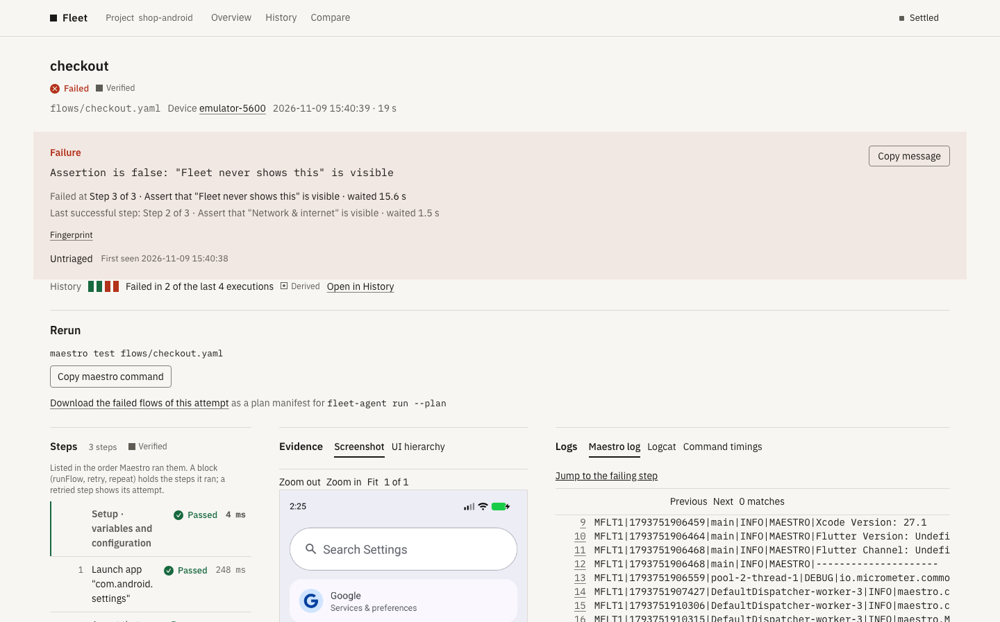

# Fleet

[](https://github.com/moyaver/fleet/actions/workflows/ci.yml)
[](LICENSE)
[](https://github.com/moyaver/fleet/releases)

Fleet is the home for your mobile end-to-end tests. Run them in your own CI, watch them live, and keep every failure's evidence and history in one place. Next, it groups results by app build and lets you choose what runs.

> **Self-hosted alpha today; no hosted tier yet. Android today; iOS next.**
> Maestro is the first runner.

<picture>
  <source media="(prefers-color-scheme: dark)" srcset="docs/assets/dashboard-run-dark.png">
  
</picture>

Fleet is for mobile teams that run [Maestro](https://github.com/mobile-dev-inc/maestro) in their own CI. It does not run your tests or provide devices, and it does not change a test's result.

## Status

**Today**

- Run `maestro test` on CI through `fleet-agent run --`
- Watch runs, devices and runners live, with the evidence for each failed flow
- Organize flows in a catalog, with tags, history and compare
- Shard flows across CI jobs by duration with the Fleet Planner

**Coming**

- One record per app build, with a release page ([W1](docs/ROADMAP.md))
- Quarantine with an owner and an expiry; infra failures are never quarantined ([W5](docs/ROADMAP.md))
- `--selection` runs the PR gate, minus quarantined flows. Your CI's cron runs it; Fleet owns no schedule ([W5](docs/ROADMAP.md))
- Guarded rerun of chosen flows from the page ([W6](docs/ROADMAP.md))
- Hosted tier: private beta with token-only sign-up ([W2](docs/ROADMAP.md))
- iOS Maestro `publish` from a Mac ([W3](docs/ROADMAP.md))
- Last night: incidents, infra label and blind banner ([W4](docs/ROADMAP.md))
- XCUITest and Espresso results ([W7](docs/ROADMAP.md))

An item moves to Today when its wave is merged on `main`. The [roadmap](docs/ROADMAP.md) has the waves and their acceptance.

## Get started

### Install the agent

Install `fleet-agent` from the `v0.1.0-alpha.4` release. It ships for Apple Silicon macOS and for Linux on x86_64 and aarch64:

```bash
curl --proto '=https' --tlsv1.2 -LsSf https://github.com/moyaver/fleet/releases/download/v0.1.0-alpha.4/fleet-agent-installer.sh | sh
```

Each archive has a SHA-256 checksum and a GitHub build attestation. The [runner guide](docs/src/runner-guide.md#install) shows how to verify one.

### Try it on a Maestro run

You can observe a run without a Fleet server. You need [Maestro](https://docs.maestro.dev/), an Android emulator or device, and an app that already runs under Maestro.

```bash
# Replace the path with your existing Maestro flows.
FLEET_RUN_DIR="$PWD/.fleet-run" fleet-agent run -- maestro test path/to/flows/
fleet-agent inspect .fleet-run/artifacts  # add --json for machine-readable output
```

Fleet passes Maestro's output through and returns Maestro's own exit status. Without `FLEET_SERVER`, observation stays local. The [user guide](docs/src/user-guide.md) covers the captured run, offline capture and `flush`. To build the agent from source, see [CONTRIBUTING.md](CONTRIBUTING.md).

### Use it in CI

Wrap the Maestro command in your existing CI step:

```yaml
- run: fleet-agent run -- maestro test flows/
```

Set `FLEET_SERVER` to send events to a Fleet server. Authenticate with GitHub Actions OIDC or a project API key (`FLEET_TOKEN`). The [GitHub Actions example](examples/github-actions/fleet-agent.yml) shows a full job, and the [Compose guide](deploy/compose/README.md) shows how to run the server.

## Principles

- **Fail open.** A Fleet outage or misconfiguration never fails a test or changes its exit status.
- **Evidence, not guesses.** Each result says where its evidence came from. Missing evidence never becomes a pass.
- **Your infrastructure.** The server and Postgres run where you put them. Sensitive values are redacted on the runner before anything is sent.

## Measured

On an Apple M1 Pro (10 cores, macOS 26.7.1), the agent used 0.19% of one core and 18.9 MiB of peak memory over three 50-second runs. The fake Maestro replayed a captured Maestro 2.12.1 suite, and the run with the agent took 0.32 s longer (median). This is one machine and a replayed suite, not a general guarantee. The raw output is in [research 15 assets](research/15-assets/), and the [runner guide](docs/src/runner-guide.md#cost) has the ranges.

Setup took 8 minutes 17 seconds for the server stack, built from source on one Mac with a throwaway emulator. A VM, DNS and public TLS were not timed. See [research 15](research/15-setup-cost.md).

A [comparative study](research/10-comparative-diagnosis-study.md) ran the same captured Maestro 2.12.1 runs through CI console output, Allure 3.33.0 and Fleet. Fleet reported the same outcome as Maestro's own JUnit report for every captured scenario (13 flows, 10 runs). Allure showed all five failing flows in its JUnit file as passed.

## Documentation

- [User guide](docs/src/user-guide.md): running and inspecting Maestro tests, offline mode, CI variables
- [Runner guide](docs/src/runner-guide.md): devices, signals, credentials, proxies and TLS
- [Operator guide](docs/src/operator-guide.md): server configuration, upgrades and load tests
- [Compose deployment](deploy/compose/README.md): self-hosting with Postgres 18, Caddy and Garage
- [Try Fleet on a free VM](docs/src/free-vm.md)
- [Roadmap](docs/ROADMAP.md), [implementation plan](docs/PLAN.md) and [changelog](CHANGELOG.md)
- [Decisions](docs/decisions/README.md) and [research](research/00-synthesis.md)
- [Contributing](CONTRIBUTING.md)

## Contributing and community

Use [GitHub Issues](https://github.com/moyaver/fleet/issues) for actionable problems and [Discussions](https://github.com/moyaver/fleet/discussions) for questions and ideas. Every contributor signs the [Contributor License Agreement](CLA.md) before a pull request is merged. Read the [contribution guide](CONTRIBUTING.md) first. Report vulnerabilities privately through [SECURITY.md](SECURITY.md). Follow the [Code of Conduct](CODE_OF_CONDUCT.md).

## License

Fleet is open source under the [GNU AGPL v3](LICENSE) (`AGPL-3.0-only`). Internal company use is permitted. The [licensing FAQ](LICENSING.md) explains what network use and distribution require. A separate commercial license is available. Contact [the maintainer](mailto:mhammadjaber00@outlook.com).

Fleet is an independent project and is **not affiliated with mobile.dev**, the makers of Maestro.
