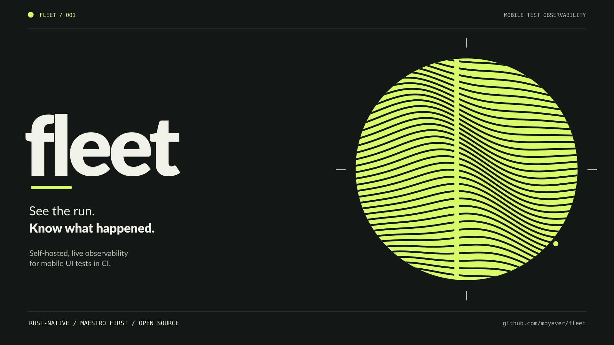

<p align="center">
  
</p>

# Fleet

[](https://github.com/moyaver/fleet/actions/workflows/ci.yml)
[](LICENSE)
[](Cargo.toml)

**Know what your mobile UI tests are doing before the CI job ends.**

Fleet is **self-hosted, live observability for mobile UI tests in CI**. It watches [Maestro](https://github.com/mobile-dev-inc/maestro) runs, connects test progress to the device and runner doing the work, and preserves the evidence behind each result — without changing how your tests execute.

[Get started](#get-started) · [How it works](#how-it-works) · [Roadmap](#roadmap) · [Documentation](#documentation)

> [!IMPORTANT]
> **Alpha pre-release.** The agent, server and browser dashboard work end to end: **M2–M5 complete**. **M6 (hardening and v1.0) is in progress.** The latest pre-release is [`v0.1.0-alpha.3`](https://github.com/moyaver/fleet/releases/tag/v0.1.0-alpha.3); interfaces may still change before 1.0.0. See the [full roadmap](docs/ROADMAP.md).

## Why Fleet?

A CI job can tell you that a mobile test suite failed. It is much harder to answer *which flow is running, which emulator it is on, whether the runner is struggling, and what actually failed* — especially when several CI jobs and devices are involved.

Fleet adds that missing observability layer. **It does not replace Maestro, schedule CI jobs, or change the outcome of a test.**

### What makes it different

- **See the run as it happens.** The agent observes flow progress, Maestro output, debug bundles, JUnit results when available, and device and host health: adb state, boot status, and guest CPU and memory for each device Maestro drives, plus per-run Maestro and agent resource use on a shared runner.
- **Never turn uncertainty into success.** Results carry their evidence source; inferred or missing evidence cannot silently become a passing test.
- **Keep CI behavior intact.** The supervisor preserves Maestro's output and exit status. A Fleet connection or observer failure does not fail the underlying test.
- **Recover from interruption.** A bounded local journal/spool and server-authoritative acknowledgments let agents reconnect and replay; gaps are recorded rather than hidden.
- **Keep your data on your infrastructure.** The server and Postgres are self-hosted. Sensitive values are redacted at the runner before telemetry is sent.
- **Evidence for a failed flow.** A failed flow keeps its failure screenshot, the failing step's UI hierarchy with on-screen text redacted, a redacted logcat excerpt around the failing step, and Maestro's log opened at that step. Steps nested by `runFlow` and retry attempts are shown as a tree.

The agent, server, and web dashboard are written in **Rust** (the dashboard is Leptos compiled to WebAssembly; no JavaScript). Fleet starts with Maestro; the underlying protocol and domain model are designed to accommodate other test runners later.

## Get started

### Install the agent (alpha pre-release)

Install `fleet-agent` from the `v0.1.0-alpha.3` release. It ships for Apple Silicon macOS and for Linux on x86_64 and aarch64 (static musl binaries):

```bash
curl --proto '=https' --tlsv1.2 -LsSf https://github.com/moyaver/fleet/releases/download/v0.1.0-alpha.3/fleet-agent-installer.sh | sh
```

Each archive has a SHA-256 checksum (listed in `sha256.sum`) and a GitHub build attestation. To verify an archive you downloaded, with the [GitHub CLI](https://cli.github.com/):

```bash
gh attestation verify fleet-agent-x86_64-unknown-linux-musl.tar.xz --repo moyaver/fleet
```

The server image is `ghcr.io/moyaver/fleet:0.1.0-alpha.3`; the [Compose guide](deploy/compose/README.md) uses it by default. That image predates the clean break, so until the next release the server is built from source too: the Compose guide's Start section has the commands. To build the agent from source instead, follow step 1.

### 1. Observe a Maestro run locally

You can try the **working agent without deploying the Fleet server**. You need [Rust](https://rustup.rs/), [Maestro](https://docs.maestro.dev/), a working Android emulator or device, and an app/test suite that already runs under Maestro.

```bash
git clone https://github.com/moyaver/fleet.git
cd fleet
cargo build --locked -p fleet-agent

# Replace the path with your existing Maestro flows.
FLEET_RUN_DIR="$PWD/.fleet-run" target/debug/fleet-agent run -- maestro test path/to/flows/
```

Fleet passes Maestro's terminal output through and returns **Maestro's own exit status**. Without `FLEET_SERVER`, observation stays local. Inspect the captured run afterward:

```bash
target/debug/fleet-agent inspect .fleet-run/artifacts
# Add --json for machine-readable output.
```

This is an **early source-build workflow**, not a production install guide. See the [user guide](docs/src/user-guide.md) for the exact observation behavior, supported flags, offline capture and `flush`.

### 2. Connect CI to a self-hosted server (optional)

The working server receives agent events over WebSocket (with an HTTPS batch fallback), persists them in **PostgreSQL 18**, and exposes a live socket plus REST/OpenAPI endpoints.

1. Follow the [Docker Compose deployment guide](deploy/compose/README.md) to configure and run Fleet with Postgres and Caddy.
2. Set `FLEET_SERVER` on your CI runner. Use GitHub Actions OIDC with an approved trust policy or a project API key (`FLEET_TOKEN`).
3. Wrap your existing command with `fleet-agent run --`. Add `fleet-agent flush` as an always-run cleanup step if desired.

The [GitHub Actions example](examples/github-actions/fleet-agent.yml) uses the composite action in [`examples/github-actions/fleet-agent`](examples/github-actions/fleet-agent/action.yml). It installs the `v0.1.0-alpha.3` agent from its checksum-verified release and runs the Maestro command under it. The job summary (failing flows, each linked to its flow page, and a dashboard link) is included from `v0.1.0-alpha.2`. Until the next release, that default cannot report to a server built from this branch: the Compose guide and the free VM guide give the source-build steps.

Setup time was measured once on a Mac, following only the docs, with a source build of the server and a throwaway Android emulator: the server stack built and came up in 8 min 17 s (its build cache state was not logged), and a local Maestro run reached the dashboard within a second of the agent starting. A VM, DNS and public TLS were not timed, and no GitHub-hosted run reached this server. Details and limits: [research/15](research/15-setup-cost.md).

> [!NOTE]
> The server serves the dashboard at `/`: live overview, pipeline detail with a device timeline, worker and device metrics, flow investigation with screenshots, UI hierarchies, logs and a nested step tree, history and compare. Browser sign-in uses your OIDC provider; uploaded evidence is served from a separate sandboxed origin. See the [user guide](docs/src/user-guide.md) and the [operator guide](docs/src/operator-guide.md).

## How it works

Fleet separates running a test from observing it:

| Component | Responsibility | State |
| --- | --- | --- |
| **`fleet-agent`** | Supervises `maestro test` without changing its result; observes logs, flow evidence, adb devices, and host metrics; buffers and sends events. | Implemented (M2) |
| **`fleet` server** | Authenticates agents, ingests and acknowledges journals, resolves evidence-backed outcomes, stores runs in Postgres, and publishes live snapshots/deltas. | Implemented (M3) |
| **Web dashboard** | Follow runs, jobs and devices from a browser and drill into failures without navigating CI logs; OIDC sign-in. | Implemented (M4) |
| **Evidence & history** | Artifact upload and viewers, failure fingerprints, flaky-test analysis, history and compare, retention, duration-aware shard planning (Fleet Planner). | Implemented (M5) |

The supervisor is **fail-open**, the event stream is **resumable**, and the server never labels a failed or interrupted job successful simply because evidence is absent. See the [architecture decisions](docs/decisions/README.md), [protocol reference](docs/src/protocol.md), and [design invariants](docs/PLAN.md#3-invariants-non-negotiable).

### Measured, not just promised

In the [Maestro phase-0 validation](research/08-phase0-results.md), a real emulator run established which progress signals could actually be observed. `cargo xtask bench-overhead` measures the agent's overhead on the captured suite, with and without the agent. On an Apple M1 Pro, a 50-second run used **0.20% of one core** and **17 MiB** of memory, and the agent added about **0.3 seconds** to the run. This is a specific measurement on one machine, **not a general performance guarantee**. See the [runner guide](docs/src/runner-guide.md#cost).

**Against other tools.** A [comparative study](research/10-comparative-diagnosis-study.md) ran the same captured Maestro 2.12.1 runs through CI-only console reporting, Allure 3.33.0 and Fleet. Measured there:

- Fleet reports the same outcome as Maestro's own JUnit report for every captured scenario in the fixture set (13 flows, 10 runs).
- Allure 3.33.0 shows every failing Maestro flow in the set as passed (5 of 5 in its JUnit file). The study traces this to Allure's JUnit reader, which ignores a failure given as text only.
- In the captured fixtures, CI-only reporting and Allure 3.33.0 cannot show the screen at a failing step. Fleet keeps the failure screenshot and UI hierarchy for it.

ReportPortal was documented in the study, not run.

## Roadmap

Fleet is being developed in milestones with tested exit criteria. The agent, server, dashboard and evidence are implemented; hardening (M6) is in progress, and the v1.0 release comes after it.

| Milestone | Deliverable | Status |
| --- | --- | --- |
| **M0–M1** | Bootstrap and real-emulator Maestro research | Complete |
| **M2** | Observability agent, parsers, metrics, local spool, transport | Complete |
| **M3** | Durable ingest, authentication, live API, Postgres, reference deployment | Complete |
| **M4** | Usable browser dashboard and end-to-end UI tests | Complete |
| **M5** | Evidence viewers, history, flaky-test signals, Fleet Planner | Complete |
| **M6** | Security hardening, RBAC, load tests, v1.0 release | In progress |

[Milestone checklists and acceptance evidence](docs/ROADMAP.md) · [GitHub milestones](https://github.com/moyaver/fleet/milestones) · [Changelog](CHANGELOG.md)

The M2 agent already accepts **plan manifests and shard assignments**, and the M3 server stores plans; the **duration-aware `fleet-planner` CLI** is available ([#15](https://github.com/moyaver/fleet/issues/15)). [Read the decision](docs/decisions/0013-fleet-planner.md) or the [Fleet Planner shards guide](docs/src/user-guide.md#fleet-planner-shards).

## Documentation

| Guide | For |
| --- | --- |
| [User guide](docs/src/user-guide.md) | Running and inspecting Maestro tests, offline mode, provenance, CI variables |
| [Runner guide](docs/src/runner-guide.md) | Device setup, signals, credentials, proxy and TLS behavior |
| [Operator guide](docs/src/operator-guide.md) | Server configuration, operations, upgrades and load testing |
| [Compose deployment](deploy/compose/README.md) | Self-hosting with Postgres 18, Caddy and Garage |
| [Try Fleet on a free VM](docs/src/free-vm.md) | One cloud VM with the reference deployment and free DuckDNS names, for trying Fleet |
| [Implementation plan](docs/PLAN.md) | Architecture, constraints, milestones and acceptance criteria |
| [Research](research/00-synthesis.md) | Evidence behind design decisions and Maestro integration |
| [ADRs](docs/decisions/README.md) | Why the architecture is built this way |
| [Contributing](CONTRIBUTING.md) | Building, testing, conventions and pull requests |

For contributors, the Rust toolchain is pinned in [`rust-toolchain.toml`](rust-toolchain.toml). Run `cargo xtask setup` to install development tooling, then `cargo xtask ci` to run the repository's checks. See [CONTRIBUTING.md](CONTRIBUTING.md) for the full workflow.

## Contributing and community

Feedback, bug reports and contributions are welcome. Use [GitHub Issues](https://github.com/moyaver/fleet/issues) for actionable problems and [Discussions](https://github.com/moyaver/fleet/discussions) for questions and ideas.

Every contributor must sign the [Contributor License Agreement](CLA.md); see the [contribution guide](CONTRIBUTING.md) before opening a PR. Please follow the [Code of Conduct](CODE_OF_CONDUCT.md), and [report vulnerabilities privately](SECURITY.md).

## License

Fleet is open source under **[GNU AGPL v3](LICENSE)** (`AGPL-3.0-only`). Internal company use is permitted. Network use of a modified version and distribution trigger the AGPL's corresponding source obligations; see the [plain-language licensing FAQ](LICENSING.md) for details.

A separate commercial license is available for uses that need different terms. Contact [the maintainer](mailto:mhammadjaber00@outlook.com).

Fleet is an independent project and is **not affiliated with mobile.dev**, the makers of Maestro.
